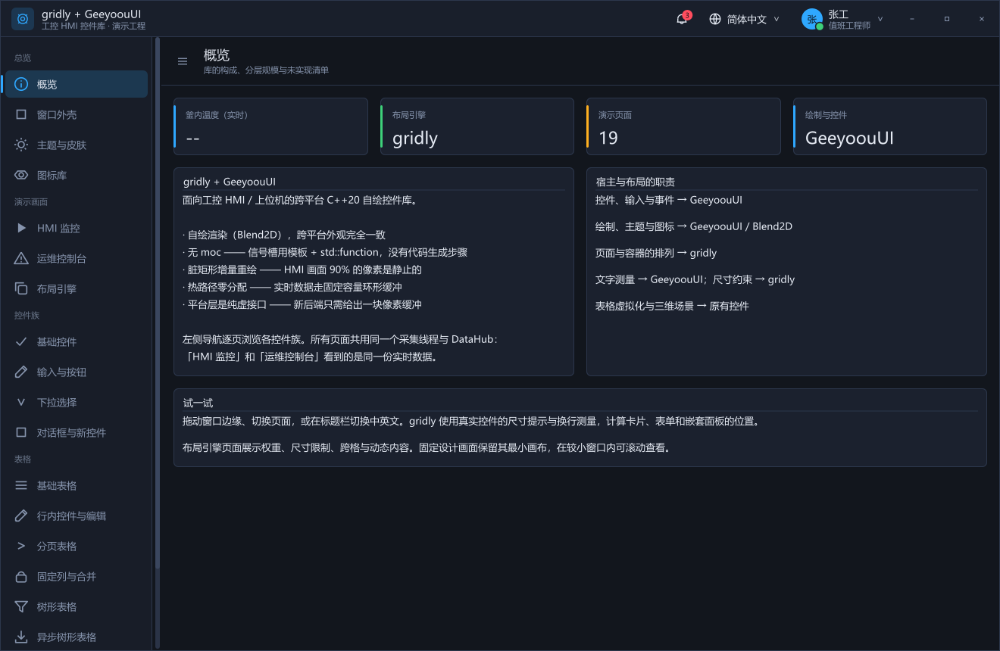
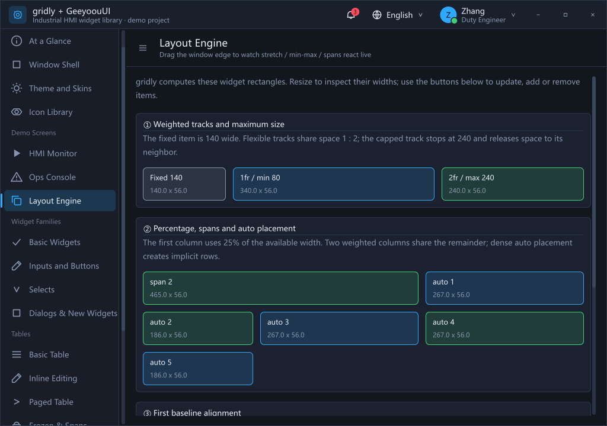
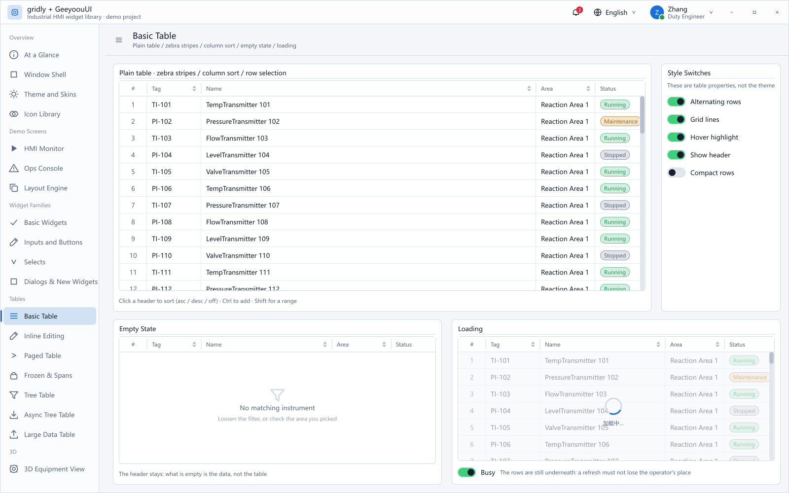

# 2026-09-28 本机宿主演示验收

构建环境：Windows、MSVC 19.51.36257.0。GeeyoouUI 固定提交、可执行文件 SHA-256、
日志 SHA-256 与本地改动状态见 [validation.json](validation.json)。

| 配置 | 本轮完整回归 | 最后一次宿主复测 |
| --- | --- | --- |
| MSVC Release | 269／269 | 2／2 |
| MSVC Debug | 269／269 | 2／2 |
| MSVC ASan（RelWithDebInfo） | 269／269 | 2／2 |

最后的尺寸提示修正仅涉及适配器，因此在三种配置中重新构建并复测两项宿主测试：
16 组适配器场景，以及 19 页 × 3 种配置的真实窗口遍历。
完整回归包含未改动的核心用例；复测覆盖最终交付的宿主源代码。

正常无参数启动另行检查：进程运行 3 秒后窗口仍响应消息；发送 WM_CLOSE 后正常退出，退出码 0。
该检查按隐藏窗口方式运行；测试结束未留下演示进程。

[pages.csv](pages.csv) 记录 57 次页面访问时的窗口尺寸、控件数和 gridly 布局数。
[summary.json](summary.json) 来自 Release 复测；计算失败和中断均为 0。
其中测量次数是整套演示的累计诊断数据，**不作为性能 benchmark 或与 Taffy 的对比结果**。

启用宿主演示后的安装检查仍只有 11 个 gridly 公共头文件、一个静态库和四个 CMake 文件；
GeeyoouUI／Blend2D／AsmJit 没有进入核心安装包。
新增远端 CI 作业已写入工作流，本轮未提交或触发该作业。

实际原生 DPI 为 100%。另外检查了 100%／125%／150%／200% 的逻辑矩形到物理像素边缘，
尚未进行真实多显示器 DPI 切换。未声称覆盖所有控件的人工交互组合。

截图通过宿主 Canvas 渲染同一控件树，窗口事件与布局来自真实 Win32 宿主。

## 概览：中文、深色、1320×860

## 布局演示：英文、深色、1024×720

## 表格：英文、浅色、1600×1000

