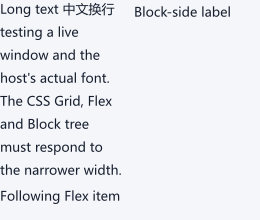

# GeeyoouUI 新 CSS 树宿主验收

本机 Windows 11／MSVC，以固定的 GeeyoouUI 提交
`4cadaf6479b663ce6633e59bfbac28332de495fc` 构建。
示例层的 `CssAxislyLayout` 把宿主直接子控件映射为 CSS 测量叶，
使用虚拟容器在一棵 `css::LayoutTree` 中表达 Grid→Flex→Block。
宿主仍提供真实 `Label::sizeHint()`／`heightForWidth()` 和绘制；
适配器在所有测量成功后统一发布几何，并在重入后检查宿主生命期。

验收输入：两列等分、8 px 列间距的 Grid；第一列是纵向 Flex，
放置自动换行 Label 与其后的 Label；第二列是 Block，放置另一
Label。用 400→240 px 宽度变化、文字增长、可见子项删除及
100%／125%／150%／200% 像素边缘检查验证行为。
真实 Win32 Showcase 窗口在原生 100% DPI 下另执行 430→260 px
缩放、文字换行和位置检查，并从仍附着在窗口上的 CSS 宿主控件
导出独立截图。原生多显示器 DPI 切换尚未验证。

Release 宿主构建通过 293/293 项；Debug 宿主构建通过 293/293 项。
MSVC ASan 宿主构建通过 293/293 项。三种配置均含适配器单元检查与
真实窗口 19 页 × 3 配置遍历。独立安装目录有 17 个 axisly 公共头文件、
一个静态库和四个 CMake 文件，未安装 GeeyoouUI／Blend2D／AsmJit；
从该前缀重新配置、链接并运行独立消费程序也通过 1/1 项。
[验证哈希和配置](validation.json)记录了三种可执行文件及截图的 SHA-256。
[Showcase 摘要](showcase-summary.json)的 `css_mixed_native` 由实际窗口
验收流程写入；旧 19 个 Showcase 页面仍使用旧 Grid 适配器，
不能将它们计入新 CSS 树页面覆盖。

本轮混合树约束重测与节点缓存改造后，重新编译 Release、Debug、
MSVC ASan 宿主，各通过 294/294 项。Release Showcase 再次运行
19 页 × 3 种窗口／语言／主题配置和原生 CSS 混合页，
`css_mixed_native=passed`、`errors=0`；安装前缀的独立消费程序通过 1/1。
CSS 混合页截图的 SHA-256 与上图相同，说明此验收输入的像素输出未变。
[本轮验证记录](validation-parity.json)和
[Showcase 摘要](showcase-parity-summary.json)保存了可核对结果。

固有尺寸查询分层后，Release／Debug／MSVC ASan 宿主各通过 296/296 项；
Release 的真实 Showcase 仍遍历 19 页 × 3 配置，并通过原生 CSS 混合页。
安装前缀的独立消费者重新配置、链接并通过 1/1 项。CSS 混合页截图哈希
与前两轮相同。[本轮验证记录](validation-detail.json)和
[Showcase 摘要](showcase-detail-summary.json)保存了结果；实际跨显示器 DPI
切换仍需单独验收。

四层纵横比与百分比尺寸差分修正后，再次编译并运行 Release／Debug／
MSVC ASan 宿主，各通过 296/296 项。Release Showcase 遍历 19 页 × 3
配置，原生 CSS 混合页通过，`errors=0`；安装前缀的独立消费者通过 1/1。
CSS 混合页截图 SHA-256 与之前相同。
[本轮验证记录](validation-ratio-deep.json)和
[Showcase 摘要](showcase-ratio-deep-summary.json)保存了结果。

根 Block 已知尺寸选择重构后，Release／Debug／MSVC ASan 宿主再次各通过
296/296 项；安装前缀独立消费者通过 1/1。Release Showcase 的 19 页 × 3
配置及原生 CSS 混合页继续通过，截图 SHA-256 未变。
[本轮验证记录](validation-root-ratio.json)和
[Showcase 摘要](showcase-root-ratio-summary.json)保存了结果。

测量叶节点与项目尺寸阶段重构后，Release／Debug／MSVC ASan 宿主
各通过 296/296，安装前缀消费者通过 1/1。Release 真实窗口的
19 页 × 3 配置和原生 CSS 混合页均通过，截图 SHA-256 未变；
布局与测量次数分别为 5212 和 9969。
[本轮验证记录](validation-replaced-leaf.json)和
[Showcase 摘要](showcase-replaced-leaf-summary.json)保存了结果。
实际跨显示器 DPI 和更多新 CSS 树页面仍需验收。

叶节点测量约束阶段独立重构后，Release／Debug／MSVC ASan 宿主各通过
297/297，安装前缀消费程序通过 1/1。Release 的 19 页 × 3 配置及原生
CSS 混合页继续通过；本轮布局／测量次数为 5217／9984，截图哈希未变。
[验证记录](validation-leaf-space.json)和 [真实窗口摘要](showcase-leaf-space-summary.json)
保留了结果。实际跨显示器 DPI 和更多新 CSS 页面仍待验收。
